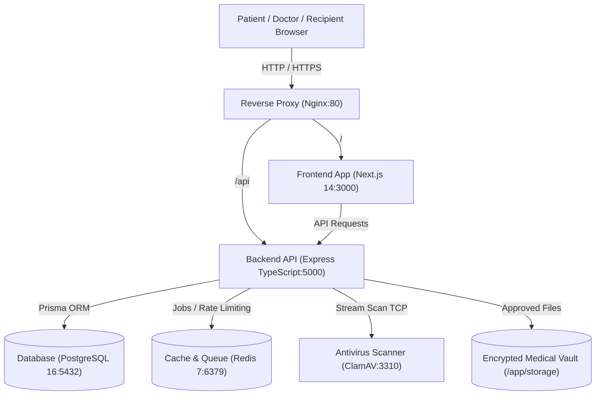

# HealthVault

> **A secure, patient-centric digital health-record wallet and sharing platform — designed like DigiLocker for healthcare.**

[](https://github.com/Mansityagi130/Healthvault/releases)
[](LICENSE)
[](https://www.typescriptlang.org/)
[](https://nextjs.org/)
[](https://expressjs.com/)
[](https://www.postgresql.org/)
[](https://www.docker.com/)

---

## 📂 Project Versions

This repository contains both versions of the HealthVault project organized into dedicated top-level folders:

| Folder | Release Tag | Description | Key Capabilities |
| :--- | :--- | :--- | :--- |
| [📁 **Version 1**](./Version%201) | [`v1.0.0`](https://github.com/Mansityagi130/Healthvault/releases/tag/v1.0.0) | Original baseline release (Aug–Sep 2026) | Baseline multi-tier architecture, patient auth, clinical records CRUD |
| [📁 **Version 2**](./Version%202) | [`v2.0.0`](https://github.com/Mansityagi130/Healthvault/releases/tag/v2.0.0) | Production-hardened release (Oct 2026) | Instant 24-hr QR sharing, ClamAV antivirus, emergency profile, appointments, PDF export |

👉 **Click [📁 Version 1](./Version%201) or [📁 Version 2](./Version%202) above to explore the code for each version directly!**

---

## 1. Project Purpose & Problem Statement

In modern healthcare, patients face fragmented medical histories spread across paper prescriptions, hospital portals, pathology labs, and diagnostic imaging centers. When seeking a second opinion, visiting an emergency room, or consulting an independent physician, patients struggle to compile and share their medical context quickly and securely.

**HealthVault** solves this by putting patients in complete control of their medical records. Rather than forcing every clinic or hospital to adopt a centralized proprietary platform, HealthVault lets an individual:
1. Store and organize their health history (prescriptions, diagnostic lab results, imaging scans, discharge summaries).
2. Generate an **instant 24-hour secure QR code or direct link** to share records with any doctor or family member without selecting a doctor in advance.
3. Maintain a critical **Emergency Medical Card** (blood group, severe allergies, chronic conditions, emergency contacts) instantly accessible to first responders.
4. Schedule and manage healthcare appointments.
5. Export branded PDF clinical summaries on demand.

---

## 2. Target Users & Primary Use Cases

- **Patients & Families**: Maintain lifelong health records, upload photo/PDF reports, monitor vital statistics, and grant temporary access to specialists.
- **Independent Physicians & Specialists**: Review authorized patient medical records and diagnostic history on any smartphone or tablet without creating platform accounts.
- **First Responders & Emergency Personnel**: Rapidly scan and inspect critical emergency demographic profiles and allergy warnings during trauma triage.
- **Healthcare Coordinators & Administrators**: Coordinate appointments and view tamper-evident access audit trails.

---

## 3. Key Capabilities (Version 2)

- 🔒 **Instant Patient-to-Patient QR & Link Sharing**: Create self-service 24-hour QR codes and direct links without selecting doctors in advance.
- 🛡️ **ClamAV Antivirus Defense**: Automated daemon scanning for all uploaded medical PDFs and images with fail-closed quarantine isolation.
- 🚨 **Emergency Medical Profile**: Rapid-access emergency card detailing blood group, critical allergies, and emergency contacts.
- 📅 **Appointment Management**: Multi-party appointment booking and status tracking.
- 📄 **Server-Side PDF Summary Dossier**: Automated generation of comprehensive health summaries using `pdfkit`.
- 🔍 **Auditing & Governance**: Complete event logging of all file views, report shares, downloads, and emergency lookups.
- ⚡ **Real-Time Notifications**: Server-Sent Events (SSE) notification stream with read/dismiss management.

---

## 4. Capability Status Matrix

| Capability | Status | Notes |
| :--- | :--- | :--- |
| **Patient Health Records & Document Vault** | ✅ **Verified & Tested** | Multi-category uploads, preview, download |
| **Instant 24-Hour QR Report Sharing** | ✅ **Verified & Tested** | Recipient authentication, 24-hr TTL, instant revocation |
| **Antivirus Malware Quarantine Pipeline** | ✅ **Verified & Tested** | ClamAV TCP daemon integration (`healthvault-clamav`) |
| **Emergency Profile & Provider Lookup** | ✅ **Verified & Tested** | CRUD profile, audited emergency access |
| **Appointment Scheduling Engine** | ✅ **Verified & Tested** | Patient booking, provider listing, cancellations |
| **Branded PDF Export Dossier** | ✅ **Verified & Tested** | Server-side rendering with `pdfkit` |
| **Security Audit Logs Viewer** | ✅ **Verified & Tested** | User and administrator audit logging |
| **Hospital & Provider Clinical Portals** | ⚠️ **Functional Prototype** | Included for demonstration; excluded from pilot |
| **ABDM / ABHA Sandbox Gateway** | 📋 **Structured Specifications** | Awaiting production Sandbox credentials from NHA |

---

## 5. Technology Stack

- **Frontend**: Next.js 14+ (App Router), React 18, TypeScript, Tailwind CSS, Lucide React, `qrcode.react`, `@zxing/browser`.
- **Backend**: Node.js, Express, TypeScript, Zod schema validation, Helmet, CORS, Rate Limiting, `pdfkit`, `nodemailer`, `@aws-sdk/client-s3`.
- **Antivirus Service**: ClamAV TCP Daemon (`clamav/clamav:latest`, internal port 3310).
- **Database & ORM**: PostgreSQL 16 Alpine, Prisma ORM 5 (26 migrations).
- **Cache & Message Queue**: Redis 7 Alpine, BullMQ.
- **Reverse Proxy**: Nginx Alpine (security headers, gzip/brotli compression, SSL termination).
- **Testing**: Vitest `v3.2.7`, Supertest (50 test suites, 78+ passing tests).
- **DevOps**: Docker & Docker Compose.

---

## 6. High-Level Architecture



👉 **For complete architectural details and sequences, see [docs/ARCHITECTURE.md](docs/ARCHITECTURE.md).**

---

## 7. Repository Structure

```text
Healthvault/
├── Version 1/                  # Original Version 1 project files (v1.0.0)
│   ├── backend/
│   ├── frontend/
│   ├── nginx/
│   ├── docker-compose.yml
│   └── README.md
├── Version 2/                  # Production-hardened Version 2 project files (v2.0.0)
│   ├── backend/
│   ├── frontend/
│   ├── nginx/
│   ├── docker-compose.yml
│   └── README.md
├── docs/                       # Project documentation
│   ├── ARCHITECTURE.md         # Architecture, modules & data flow
│   ├── BACKUP_AND_DISASTER_RECOVERY.md
│   ├── SETUP_AND_DEVELOPMENT.md
│   ├── TESTING_AND_VERIFICATION.md
│   ├── VERSION_1.md            # Version 1.0 release notes
│   ├── VERSION_2.md            # Version 2.0 release notes
│   └── VERSION_COMPARISON.md   # Side-by-side technical comparison
├── CHANGELOG.md                # Comprehensive release changelog
├── LICENSE                     # MIT License
├── README.md                   # This root documentation file
└── .gitignore                  # Security-hardened git exclusion rules
```

---

## 8. Quickstart (Running Version 2 via Docker)

```bash
# 1. Clone the repository
git clone https://github.com/Mansityagi130/Healthvault.git
cd Healthvault/"Version 2"

# 2. Configure environment
cp .env.example .env

# 3. Start all services
docker compose up -d --build

# 4. Verify running services
docker compose ps
```

Visit [http://localhost](http://localhost) in your browser.

👉 **For detailed local development instructions, see [docs/SETUP_AND_DEVELOPMENT.md](docs/SETUP_AND_DEVELOPMENT.md).**

---

## 9. Testing & Verification

Execute verified test suites against the Version 2 backend service:

```bash
cd "Version 2/backend"

# Run unit tests (redirect security, email transport, production secrets)
npm test -- tests/redirect-security.unit.test.ts tests/email-transport.unit.test.ts tests/production-secrets-hardening.unit.test.ts

# Run QR sharing integration test
npm test -- tests/patient-report-qr-sharing.integration.test.ts

# Verify backend TypeScript compilation
npm run build
```

👉 **For full test results and verification logs, see [docs/TESTING_AND_VERIFICATION.md](docs/TESTING_AND_VERIFICATION.md).**

---

## 10. Security & Privacy Principles

1. **Patient Autonomy**: Medical records are never shared without explicit, revocable patient authorization.
2. **Zero-Trust QR References**: Sharing tokens are cryptographically random, opaque identifiers with a 24-hour lifetime. No medical data or patient identity is encoded in QR code strings.
3. **Malware Defense**: All file attachments pass through ClamAV before entering storage. Unscanned or suspect files fail closed.
4. **Secrets Isolation**: Real credentials and database passwords must never be committed. Production boots fail fast if weak keys are detected.
5. **Tamper-Evident Audit Trails**: Every clinical record view, download, share, and emergency access is logged with timestamp, user ID, and IP address.

---

## 11. Documentation Index

- [📁 Browse Version 1 Code](./Version%201)
- [📁 Browse Version 2 Code](./Version%202)
- [System Architecture](docs/ARCHITECTURE.md)
- [Version 1 vs Version 2 Comparison](docs/VERSION_COMPARISON.md)
- [Version 1.0 Release Notes](docs/VERSION_1.md)
- [Version 2.0 Release Notes](docs/VERSION_2.md)
- [Setup & Local Development](docs/SETUP_AND_DEVELOPMENT.md)
- [Testing & Quality Verification](docs/TESTING_AND_VERIFICATION.md)
- [Backup & Disaster Recovery](docs/BACKUP_AND_DISASTER_RECOVERY.md)
- [Changelog](CHANGELOG.md)

---

## 12. License

This project is licensed under the MIT License — see the [LICENSE](LICENSE) file for details.
