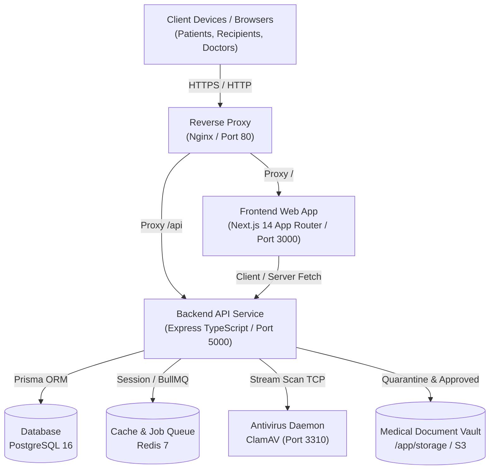
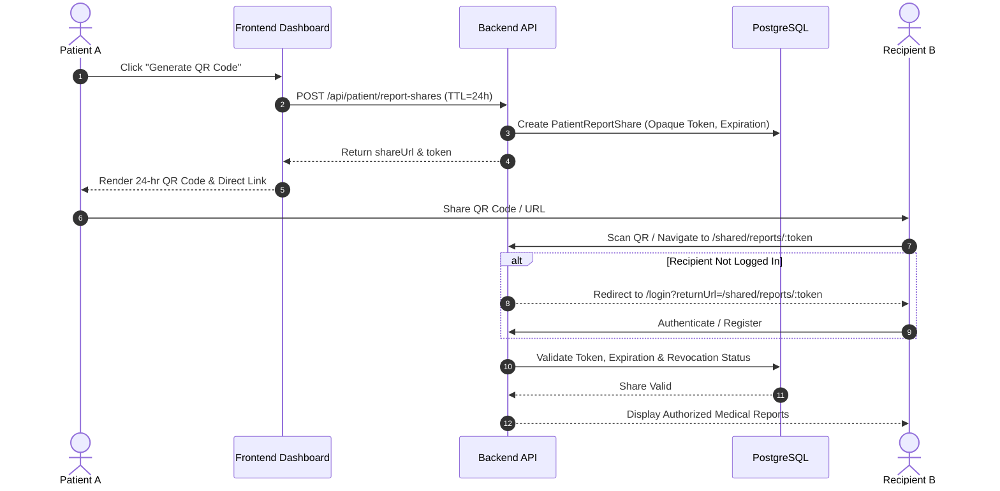
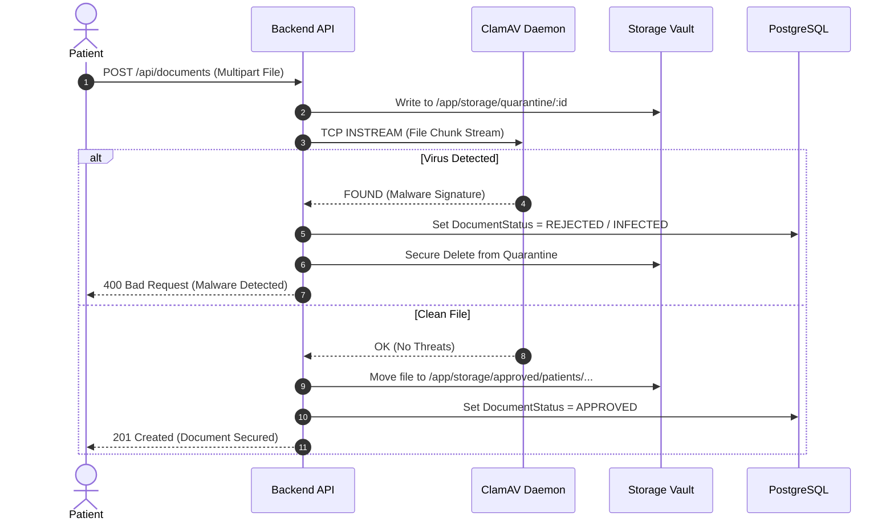

# HealthVault — System Architecture

## 1. System Overview

**HealthVault** is an enterprise-grade digital health-record wallet built for healthcare data self-sovereignty. The platform is designed around a multi-tier microservice architecture deployed via Docker containers, adhering to strict data isolation, zero-trust sharing, and privacy-by-design principles.

---

## 2. Core Architecture Modules

### A. Reverse Proxy (Nginx)
- **Role**: Entry point for all inbound traffic on port 80.
- **Responsibilities**:
  - Routing web traffic to `healthvault-frontend:3000`.
  - Routing API traffic (`/api/`) and report shares (`/shared/reports/`) to `healthvault-backend:5000`.
  - Enforcing security headers (`HSTS`, `X-Content-Type-Options`, `X-Frame-Options`, `Content-Security-Policy`).
  - Gzip and Brotli compression for static bundles.

### B. Frontend Application (Next.js 14 App Router)
- **Framework**: Next.js 14 with TypeScript and Tailwind CSS.
- **Key Modules**:
  - `(auth)`: Login, registration, password reset, and invitation acceptance.
  - `(dashboard)`: Patient self-service portal (records, documents, appointments, emergency profile, sharing).
  - `(provider)`: Clinical doctor encounter management and emergency record lookup.
  - `(hospital)`: Healthcare facility administrator coordination portal.
  - `(admin)`: Platform-level hospital onboarding verification.
  - `shared/reports/[token]`: Dedicated authenticated external recipient viewer for QR/link shares.

### C. Backend API Service (Express & TypeScript)
- **Architecture**: Controller-Service-Repository pattern with centralized error handling and Zod input validation schemas.
- **Core Services**:
  - `ReportShareService`: Cryptographic token generation, 24-hour TTL lifecycle, authorization validation, and instant revocation.
  - `DocumentService` & `ScannerFactory`: Multipart file uploads, stream piping to ClamAV, file metadata hashing, and directory isolation (`/app/storage/quarantine` vs `/app/storage/approved`).
  - `EmergencyService`: Patient demographic profiles and emergency lookup endpoints.
  - `AppointmentService`: Scheduling state machine (Pending -> Confirmed -> Completed / Cancelled).
  - `PdfExportService`: Server-side PDF rendering using `pdfkit`.
  - `AuditLogService`: Tamper-evident logging of authentication, record access, and sharing events.

### D. Data Persistence & Caching
- **Primary Database**: PostgreSQL 16 Alpine running on internal Docker network (host mapped to `5433` for administrative inspection). Managed via Prisma ORM with 26 migration steps.
- **Cache & Message Broker**: Redis 7 Alpine supporting session caching, rate-limiting counters, and BullMQ background task processing.

### E. Malware Defense Engine (ClamAV)
- **Container**: `healthvault-clamav` (`clamav/clamav:latest`).
- **Scanning Protocol**: INSTREAM socket protocol over TCP port 3310.
- **Policy**: **Fail-Closed**. If ClamAV is offline or busy, file status remains `PENDING_SCAN` and the file cannot be served or shared.

---

## 3. Data Flow & Security Sequences

### A. Patient-to-Patient QR Sharing Workflow

### B. Medical Document Upload & Antivirus Quarantine

---

## 4. Configuration and Environment Principles

1. **Defense in Depth**: Database and Redis ports are never exposed to public ingress; only Nginx port 80/443 is published.
2. **Fail-Fast Secrets Validation**: The application refuses to initialize in production if secrets are undefined, shorter than 32 characters, or match known development placeholders.
3. **Open Redirect Mitigation**: Post-login redirection targets are validated against an internal route whitelist to prevent phishing attacks.
4. **Least Privilege Data Access**: Multi-tenant patient isolation ensures SQL queries enforce ownership scoping (`patientId = req.user.id`).
